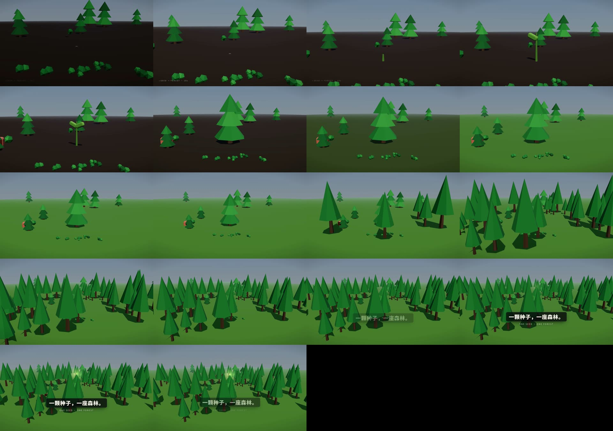

# story-to-film

**写一个故事，得到一条 3D 短片：0 素材，每一帧都由代码算出来。**

一个 AI agent 可执行的 skill（方法论 + 可运行骨架）：把一段文字拆成 8 拍，翻译成「看得见的动作」，
再用 three.js + 一条 GSAP 时间线把它搭出来 —— 不需要建模、不需要剪辑软件、不需要素材库。



▶ [`examples/seed-to-forest.mp4`](examples/seed-to-forest.mp4) — 18 秒示例（720p，1.2 MB）
　 源码在 [`examples/seed-to-forest/`](examples/seed-to-forest/)：**完整工程**，可以照抄成自己的片子。

---

## 它到底能做出什么

一条 15–90 秒的片子，画面全部由代码算出来：地面、树、房子、角色、光、粒子，没有一个素材文件。
你能改的是数字：几秒长出树、镜头怎么走、字幕说什么。改完重渲，还是同一条片子（可复现）。

这不是"AI 生成视频"，是**用代码搭一个微缩世界，再用时间线把它演出来**——所以它稳、可审片、可交付。

## 为什么是「代码生成」

- **可复现**：同一条时间线，每次都渲出同一部片子。没有"这一步手工调一下"。
- **可修改**：想改节奏？改数字。想换主角？改一个工厂函数（见 `references/03-world-kit.md`）。
- **可审片**：任意一帧都能单独 `seek` 出来截图，审片看的就是成片那一帧。
- **无素材**：没有版权问题，没有"找不到合适的图"。

## 快速开始

```bash
git clone https://github.com/huakan88/story-to-film && cd story-to-film

# ① 先看成品：示例工程 18 秒，源码就是它自己
om still  examples/seed-to-forest --at 1,6,12,17   # 四个关键时刻
om render examples/seed-to-forest --fps 60         # → examples/seed-to-forest/out/*.mp4

# ② 再看骨架（8 秒，最小可运行）
om still  assets/skeleton --at 0.5,2,5,7.5
om render assets/skeleton --fps 60

# ③ 开一个新工程，改成你的故事
node scripts/new-film.mjs my-film --title "一只猫的春天"
cd my-film
om still  . --at 1,6,11,16
om render . --fps 60                            # → out/my-film-v1.mp4
```

> 没装 `om`（`huashu-motion` 的 CLI）也能出片：页面暴露了 `window.film.seek(t)`，
> 任何能"seek + 截图"的无头浏览器都能逐帧渲染，再用 ffmpeg 合成
> （见 `references/04-timeline.md`）。
>
> 想离线/可复现渲染：先 `node scripts/vendor-three.mjs .`，把 three + GSAP 冻结到 `vendor/`。

## 作为 agent skill 安装

```bash
git clone https://github.com/huakan88/story-to-film ~/.agents/skills/story-to-film
# （或你所用工具的 skills 目录）
```

装好之后，当你说「把这段故事做成一条短片 / 做个构建片」，agent 会：

1. 把故事改写成 8 拍（`references/01-story-to-beats.md`）
2. 逐条翻译成叙事动作（`references/02-shot-grammar.md` 的 22 行动作字典）
3. 用 `assets/skeleton/` 搭世界，先做最难的镜头
4. 冷审片（`references/06-review.md`），修一轮
5. 出片、交付、写诚实清单

## 方法论：60 秒版

**故事 → 8 拍 → 动作 → 世界 → 时间线 → 审片 → 出片**

| 拍 | 构建片 | 故事片 |
|---|---|---|
| hook | 一句指令 / 一个空场 | 角色 + 它想要的东西 |
| 起 | 第一个大动作落地 | 常态被打破 |
| 铺 | 生长类动作，越来越快 | 尝试、失败、再失败 |
| burst | 规模爆炸（一片 / 一群 / 整座） | 转折：换个办法 |
| 暗 | 天黑 / 静音 / 空镜 | 代价 |
| 亮 | 点亮 / 全景 | 用新的方式完成 |
| 落点 | 一句话，停住 | 全景 + 一句话 |

三条硬规则：

1. **每个镜头必须有一个动词**（长出来 / 亮起来 / 塌下去）。没有动词的镜头删掉。
2. **能量必须有形**：hook 在 3 秒内，burst 只有一个，暗拍必须真的暗。
3. **每一帧都是时间的纯函数**：无 `Date.now`、无 `Math.random`、无跨帧状态。

## 仓库结构

```
SKILL.md                    agent 入口：触发条件 + 六阶段 + 五条铁律
references/
  01-story-to-beats.md      故事 → 8 拍 + 能量曲线 + 时长预算
  02-shot-grammar.md        ★ 叙事动作 → 镜头语法（22 行字典，本仓库的核心）
  03-world-kit.md           世界套件 API：角色工厂 / 体素 / 道具 / 相机 / 灯光 / 性能
  04-timeline.md            时间线契约、确定性、接 om、没 om 怎么渲染
  05-sound-and-voice.md     配乐、音效打点、旁白与字幕
  06-review.md              冷审片流程 + 12 条验收 + 失败模式速查
assets/
  skeleton/                 ★ 能直接渲染的工程（8 秒示例片）
    index.html              组装壳：时间线 + STORY 块 + 字幕 + 音效打点
    world-kit.js            20KB 世界套件（window.WORLD_KIT）
    ui.js / ui.css          2D 层：一个 UI.frame(t) 纯函数
    README.md               四个文件怎么改
  beats-template.md         一页纸分镜表（复制填写）
scripts/
  new-film.mjs              从骨架新建一个工程
  vendor-three.mjs          冻结 three/gsap 到本地
  qa-sheet.mjs              成片联络表（给冷审片看）
examples/
  seed-to-forest/            ★ 完整示例工程（18 秒）：story.md + index.html + ui + world-kit
  seed-to-forest.mp4         示例成片（720p / 30fps 预览版，源码渲染的是 1080p60）
  poster.jpg / sheet.jpg     海报帧 + 联络表
```

## 这份仓库验证过什么

在 Windows + Chrome + `om`（huashu-motion 0.1.0）上实测：

| 项 | 结果 |
|---|---|
| `om check examples/seed-to-forest` | **0 errors**，2 条字幕占位文案的 `low-contrast` 警告（该时刻字幕未显示，画面上不可见） |
| `om render examples/seed-to-forest --fps 60` | 18 秒 / 1920×1080 / 60fps → 1080p 成片约 6.6 MB |
| 渲染成本 | 1080p60 约 **140 ms/帧**（18s ≈ 2.5 分钟；30s ≈ 4 分钟） |
| 骨架冷启动 | 本地 `three/` 优先，无网络请求；CDN 兜底时首次约 5 秒 |
| `node scripts/new-film.mjs` | 生成干净的工程（自动排除 `_selfcheck/`、`vendor/`、`out/`），composition id 用目录名 slug |
| `node scripts/qa-sheet.mjs` | 任意 mp4 → 联络表 + 5 张关键帧，供冷审片使用 |

## 依赖

| 依赖 | 必需 | 说明 |
|---|---|---|
| Chrome / Chromium | ✅ | 渲染器（任何能截图的无头浏览器都行） |
| Node ≥ 18 | ✅ | 跑 `scripts/*.mjs` |
| ffmpeg | ✅ | 合成成片、联络表 |
| three.js 0.181.2 | ✅ | CDN 加载，最后一档回退到本地 `vendor/` |
| GSAP 3.12.5 | ✅ | 同上 |
| `huashu-motion` 的 `om` CLI | 可选 | 静帧 / 检查 / 自动配乐 / 渲染一条龙；没有它也能出片 |

## 这套方法的边界（诚实清单）

- **写实人脸、表情表演、对话口型、复杂动作戏、真实毛发与布料**：做不好。用无脸角色、剪影、体素近似。
- **景深**：需要自写 depth-of-field 后处理，成本高，只在桌面/宏观段落值得。
- **长叙事**：单条 30–90 秒最好；超过 90 秒建议拆章，每章复用同一套镜头语言。
- **音乐**：`om sound` 是「按场景能量自动作曲」，风格接近但不是请人写的配乐。
- 示例片是**流程示范**，故意留得朴素：它的用途是教你改，不是作品集。

## License

MIT —— 用、改、商用都行，保留版权声明即可。见 [LICENSE](LICENSE)。
第三方库（three.js / GSAP）的许可证与不重分发说明见 [THIRD_PARTY.md](THIRD_PARTY.md)。
